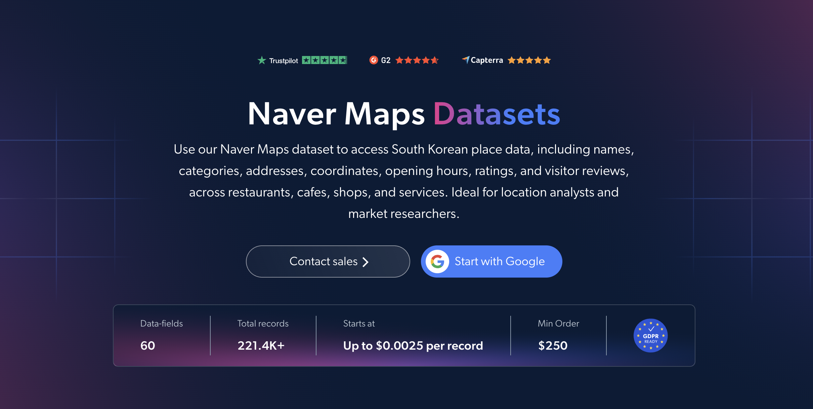

# Naver-maps-dataset-samples

<h2>A sample dataset of 1000 Naver Maps places</h2>

<a href="https://brightdata.com/products/datasets/naver">
   
</a>

A Naver Maps dataset sample of 1000 places. Dataset was extracted using the <b>Bright Data API</b>.

<h2>Some of the data points that are included in the dataset:</h2>

* ```url```: URL of the place on Naver Maps
* ```place_id```: Unique identifier for each place
* ```place_type```: Type of place, such as restaurant, accommodation, attraction or hospital
* ```name```: Name of the business or place
* ```category```: Primary category of the place
* ```all_categories```: All categories attached to the place
* ```category_code```: Naver's internal code for the primary category
* ```address```: Full road-name address in Korean
* ```address_en```: Romanized (English) road address
* ```postal_code```: 5-digit Korean postal code
* ```region```: Korean administrative region of the place
* ```lat```: Latitude of the place
* ```lon```: Longitude of the place
* ```business_status```: Current status of the business, such as open, closed or day off
* ```open_hours```: Weekly opening hours
* ```menu```: Structured menu with prices
* ```reviews_count```: Total number of visitor and blog reviews
* ```visitor_review_score```: Average score from visitor reviews
* ```visitor_review_keywords```: Most mentioned review highlights, such as taste or service
* ```nearest_transit```: Nearest public transit stations and their distance

And a lot more.

This is a sample subset which is derived from the "Naver Maps (public data)"
dataset which includes more than <b>221,000 places</b>.

Available dataset file formats: <b>JSON, NDJSON, JSON Lines, CSV, XLSX, or Parquet. Optionally, files can be compressed to .gz</b>.

Dataset delivery type options: <b>Email, API download, Webhook, Amazon S3, Google Cloud storage, Google Cloud PubSub, Microsoft Azure, Snowflake, SFTP</b>.

Update frequency: <b>Once, Daily, Weekly, Monthly, Quarterly, Biannual, or Custom basis</b>.

Data enrichment available as an addition to the data points extracted: <b>Based on request.</b>

<b>[Get the full Naver Maps dataset](https://brightdata.com/products/datasets/naver)</b>.

<a href="https://brightdata.com/products/datasets/naver">
   
</a>

<h2>What are the Naver Maps datasets use cases?</h2>

<h3>1. Local business intelligence</h3>
Businesses use Naver Maps datasets to map local businesses across South Korea by category and area. With addresses, coordinates, regions and opening hours, companies can size local markets, find gaps in coverage and build targeted lead lists.

<h3>2. Review and reputation tracking</h3>
Brands and local marketers analyze review counts, visitor review scores and review keywords to measure how places are perceived. This shows what Korean customers value most and how a business compares with nearby competitors.

<h3>3. Location and site selection</h3>
Retail, restaurant and real estate teams use place categories, coordinates and nearby transit data to evaluate locations. Comparing competitor density and menu prices by area supports decisions on where to open new branches and how to price them.

<h2>Free access to web scraping tools and datasets for academic researchers and NGOs</h2>

The Bright Initiative offers access to Bright Data's <b>[Web Scraper APIs](https://brightdata.com/products/web-scraper)</b> and <b>[ready-to-use datasets](https://brightdata.com/products/datasets)</b> to leading academic faculties and researchers, NGOs and NPOs promoting various environmental and social causes. You can submit an application <b>[here](https://brightinitiative.com)</b>.
